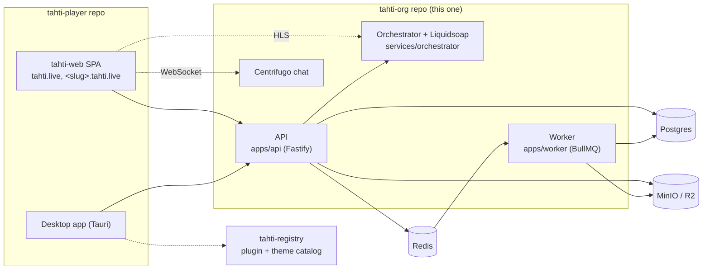

# Tahti.live

A nonprofit broadcasting platform owned and governed by its artist members. Tahti ry is a Finnish nonprofit association (yhdistys): no shareholders, no advertising, no exit. Members pay €40/year (or use the free tier), 90% of operating surplus goes back to artists as annual grants, and fan subscriptions go straight to the artist minus a 2% fee that rolls into the grant pool. Every artist member has a vote and the membership elects the board. Everything is [AGPL-3.0](https://www.gnu.org/licenses/agpl-3.0.en.html). This repo holds the API, worker, infra, ops and the org's constitution and strategy docs.

The three [constitutional rules](docs/CONSTITUTION.md):

1. This is for artists, not for corporate. Administration paid fairly. No profit motive.
2. Highest quality, useful, community-driven platform - by design.
3. The artist shines brightest. We don't rip off anyone in the chain.

## How it fits together



The web client lives in [tahti-player](https://github.com/janiluuk/tahti-player) (`packages/tahti-web`) and serves every public host; `beta.tahti.live` redirects to `tahti.live`. Full system map: [tahti-player `docs/ARCHITECTURE.md`](https://github.com/janiluuk/tahti-player/blob/master/docs/ARCHITECTURE.md).

## Quick start

Node.js 24+ (`nvm install && nvm use`), pnpm and Docker.

```bash
pnpm install --frozen-lockfile
docker compose -f infra/docker-compose.dev.yml up -d postgres redis
pnpm --filter @tahti/db db:generate
pnpm --filter @tahti/db db:migrate:test   # prisma db push
pnpm ci:check && pnpm test                 # lint, format, typecheck, Vitest

make stack-up                              # full stack in Docker, API on :15011 (--seed: ./scripts/stack-up.sh --seed)
```

Public API reference: [api.tahti.live](https://api.tahti.live/) (OpenAPI at `/api/openapi.json`).

## Docs

| Topic | Doc |
| --- | --- |
| Mission, money, governance | [`docs/about.md`](docs/about.md), [`docs/CONSTITUTION.md`](docs/CONSTITUTION.md) |
| What Tahti solves, area by area | [`docs/product-overview.md`](docs/product-overview.md) |
| Screenshots | [`docs/screenshots.md`](docs/screenshots.md) |
| Decisions (settled) | [`docs/DECISIONS.md`](docs/DECISIONS.md) |
| Numbers: model, budget, headline figures | [`docs/financial-model.md`](docs/financial-model.md), [`docs/budget-detailed.md`](docs/budget-detailed.md) |
| User guides | [`docs/guides/README.md`](docs/guides/README.md) |
| Testing and local setup | [`docs/testing.md`](docs/testing.md) |
| API map | [`docs/api/README.md`](docs/api/README.md) |
| Deploys and CI releases | [`ops/DEPLOY.md`](ops/DEPLOY.md), [`ops/RUNBOOK.md`](ops/RUNBOOK.md) |
| Agents | [`AGENTS.md`](AGENTS.md), [`docs/AGENT.md`](docs/AGENT.md) |
| Everything else | [`docs/README.md`](docs/README.md) |

## License

[AGPL-3.0](https://www.gnu.org/licenses/agpl-3.0.en.html). Artists keep full copyright over everything they upload and broadcast.
