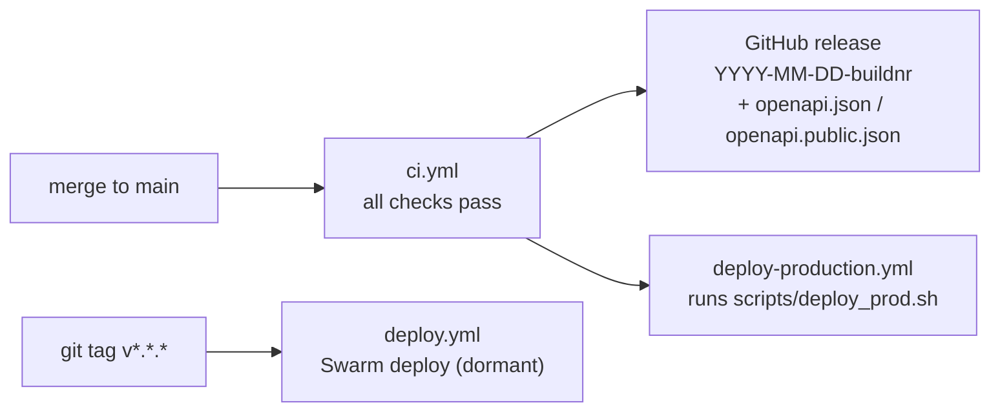

# Deploy checklist (OPS-002)

Production rolls must apply schema changes **before** API/worker/web replicas start serving traffic.

## Order of operations

1. **Build and push images** — `make build TAG=<sha> && make push TAG=<sha>`
2. **Migrate database** — `./scripts/db-migrate-deploy.sh` (see below)
3. **Deploy stack** — `make deploy TAG=<sha>`
4. **Smoke** — `curl -sf https://tahti.live/health` and one authenticated dashboard path

## Database migrations

CI and local tests use `prisma db push` (`db:migrate:test`). Production uses **`prisma migrate deploy`** (`db:migrate`).

```bash
# Manager node — DATABASE_URL must target **postgres:5432** directly (not PgBouncer)
export DATABASE_URL='postgresql://tahti:…@postgres:5432/tahti'
./scripts/db-migrate-deploy.sh

# Or run inside the API image about to be deployed
TAG=<sha> REGISTRY=registry.tahti.live ./scripts/db-migrate-deploy.sh --image
```

`make deploy` runs migrations automatically when `DATABASE_URL` is set:

```bash
DATABASE_URL='postgresql://…' make deploy TAG=<sha>
```

## Rollback

`make rollback` reverts service images only. Schema rollbacks require a planned migration or restore from backup — see `ops/RUNBOOK.md`.

## CI releases and automatic deploys



| Workflow | Trigger | What it does |
| --- | --- | --- |
| [`ci.yml`](../.github/workflows/ci.yml) | Push to `main` | Checks, then a GitHub release tagged `YYYY-MM-DD-buildnr` (UTC date + daily increment, e.g. `2026-06-03-1`) with `openapi.json` (full) and `openapi.public.json` |
| [`deploy-production.yml`](../.github/workflows/deploy-production.yml) | CI success on `main`, or manual dispatch | Deploys the stack to production with `scripts/deploy_prod.sh` |
| [`deploy.yml`](../.github/workflows/deploy.yml) | `v*.*.*` tag | Semver Swarm production deploy (manual approval). Dormant: production goes through `deploy-production.yml`. |

Preview the next release tag locally: `scripts/next-release-tag.sh`.
